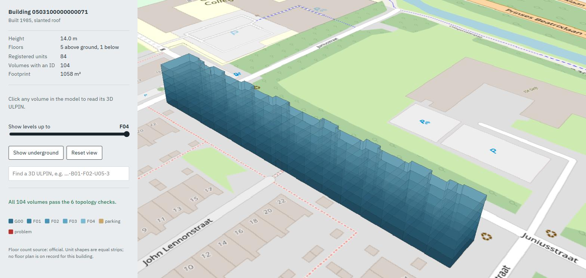
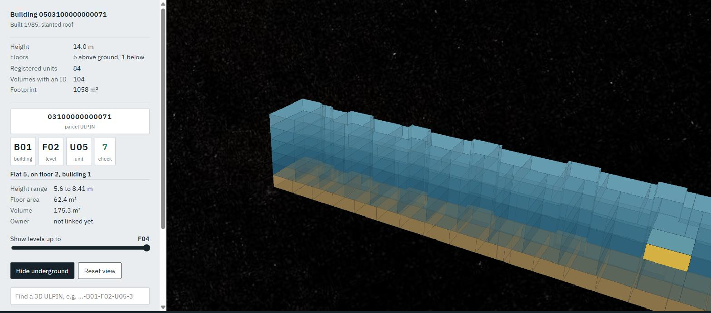
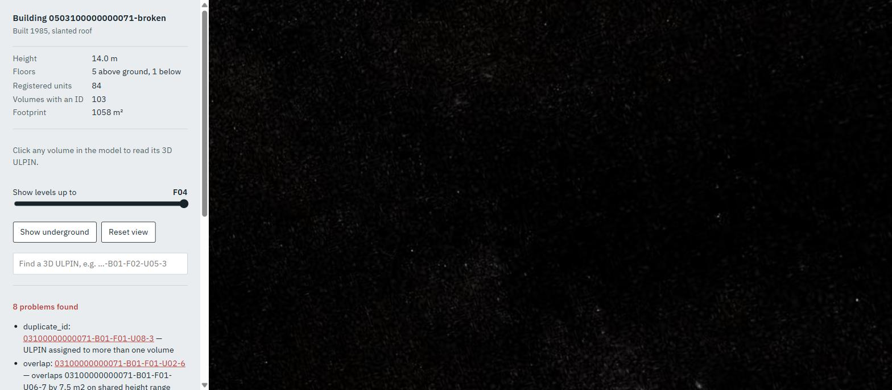
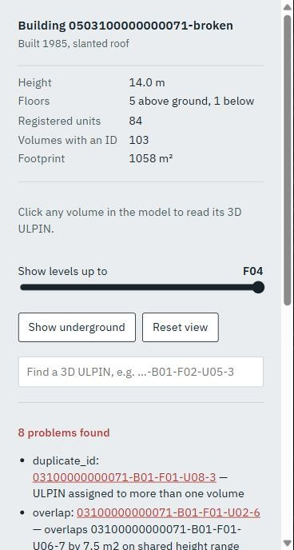
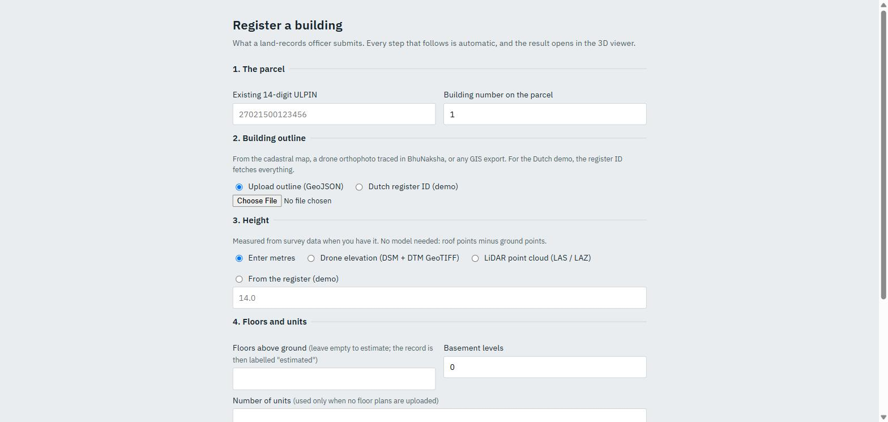
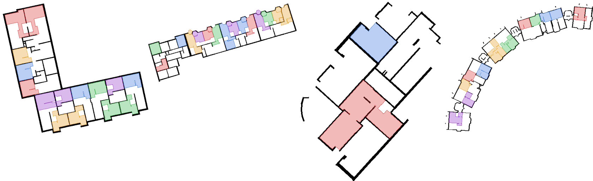
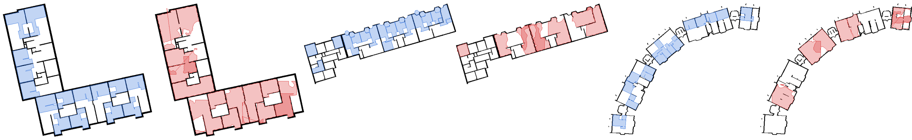
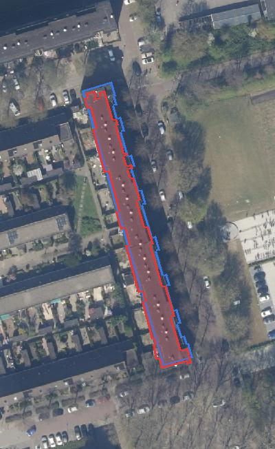

# 3D ULPIN — vertical property mapping 🏢

India's 14-digit **ULPIN** (Unique Land Parcel Identification Number, "Bhu-Aadhaar") identifies a
plot of land — in 2D. Flat 302 and flat 502 share one ID with the whole building, a basement parking
slot has no ID at all, and a water main under the plot cannot be recorded.

This project **extends the ULPIN into 3D** so every flat, floor, parking slot, common area and
underground utility gets its own **unique, verifiable ID**, and shows the result as a clickable 3D
building in the browser. Built for **Smart India Hackathon problem statement 26011** (Ministry of
Rural Development / Department of Land Resources).

```
27021500123456-B01-F05-U03-4
parcel ULPIN   bld  lvl unit check      → flat 3, 5th floor, building 1
```

The first 14 digits are the **existing ULPIN, untouched** — the system works alongside BhuNaksha and
state land records instead of replacing them. Full format: [`docs/ULPIN_SPEC.md`](docs/ULPIN_SPEC.md).



## Why this exists

Apartments, shops and parking in multi-storey buildings are bought, sold, mortgaged and taxed every
day, but the land record stops at the ground. Without an ID per unit there is no clean way to link a
flat to its owner, its share of the land, or the pipes and cables beneath it.

The fix has to be **backward compatible** (no state can throw away its parcel IDs), **human readable**
(an officer can read floor and unit off the ID), **error resistant** (a typo is caught, not filed),
**deterministic** (rerunning gives the same IDs), and **checkable in 3D** (no two flats may occupy the
same space). This prototype does all five, end to end, on real open data — at a build cost of ₹0.

## Features

- **3D ULPIN format** — parcel + building + level (`G00`, `F01–F99`, basements `B01–B09`, roof `R00`,
  air rights `A01–A09`) + unit + **Luhn check digit**. Every single-digit typo is rejected.
- **Footprint → 3D units, automatically** — extrude the outline, slice into levels, subdivide into
  units, order clockwise from north-west, stamp each volume with its ID.
- **Topology validator** — six checks: overlap, containment, gap, floating volume, duplicate ID,
  invalid ID. A deliberately broken copy of the demo building shows all five injected faults caught.
- **Clickable 3D viewer** (CesiumJS) — click any volume to read its ID, height range, area and
  volume; floor slider peels the building from the top; underground toggle shows basements and pipes.
- **Two intake routes for an officer**
  - **From map** — click any building on OpenStreetMap; gaps are filled with *labelled* assumptions
    and the record is marked *estimated*.
  - **Manual** — every value from the officer, plan or survey files; any gap is refused and the
    record is marked *surveyed*.
- **Height from survey data, no model needed** — DSM − DTM GeoTIFFs or a LAS/LAZ LiDAR point cloud.
  On the demo building: DSM−DTM 13.77 m, LiDAR 13.78 m, register 14.01 m.
- **AI only where it replaces hand-drawing**
  - a **floor-plan model** (YOLOv8s-seg) that draws each apartment from a plan image;
  - a **floor-count estimator** for buildings whose register is silent — always labelled
    `official`, `estimated` or `rule_of_thumb`;
  - **SAM** building-outline extraction from a 25 cm drone orthophoto (IoU 0.71 against the register).
- **Underground utilities** — water and sewer lines become 3D volumes with their own IDs from depth
  and diameter.
- **Standards, not a silo** — LADM (ISO 19152) PostGIS schema and **CityJSON 2.0** export, every unit
  a closed 3D solid carrying its ULPIN.



| The validator on a broken copy | What the panel reports |
|---|---|
|  |  |



## The demo building — real answers on record

BAG pand `0503100000000071`, Delft (Netherlands): the only open building found with **all three
ground truths** — official footprint and height (3DBAG laser scan), official floor count, and
registered dwelling units.

| | Register | This pipeline |
|---|---|---|
| Height | 14.01 m | 13.77 m (DSM − DTM), 13.78 m (LiDAR, 25,092 roof points) |
| Floors | 5 | 5 above ground + 1 basement (operator input) |
| Dwelling units | 84 | 84 flats + 20 basement parking slots = **104 volumes**, all with IDs |
| Ground area | 1,057 m² | 1,057.8 m² |
| Address points inside footprint | — | 84 of 84 |
| Topology checks | — | **all 104 volumes pass all 6** |

No open floor plan exists for it, so its units are equal strips per floor; the floor-plan model
replaces that step when a plan is uploaded.

## Models (both trained here, cost ₹0)

| Model | Data | Score on held-out data |
|---|---|---|
| Floor-count estimator, gradient boosting | 5,921 3DBAG buildings with an official floor count | MAE 0.20 floors, **99.5 % within one floor** (rule of thumb: 0.33, 97.5 %); valid to 22.7 m, labelled fallback above |
| Apartment segmentation, YOLOv8s-seg | Modified Swiss Dwellings (MSD), 4,569 plans / 16,148 apartments, 800 plans held out | mask mAP50 0.423, recall 0.50, precision 0.44 |

| Training labels | Truth (blue) vs prediction (red) on unseen plans |
|---|---|
|  |  |



## How it works

| Step | Code | Output |
|---|---|---|
| Download 3D model + unit register | `src/ingest/download.py` | raw CityJSON + GeoJSON |
| Footprint in EPSG:4326, area cross-checked | `src/ingest/align.py` | footprint + unit points |
| Extrude to a prism (basements = negative Z) | `src/geometry/extrude.py` | solid |
| Slice into levels B0n / G00 / F0n | `src/geometry/slice_floors.py` | one feature per level |
| Subdivide, order clockwise from NW, stamp ULPIN | `src/geometry/units.py` | unit volumes |
| Overlap / containment / gap / floating / duplicate / bad ID | `src/validate/checks.py` | JSON report |
| Floor-count estimator (only when no official count) | `src/models/floors.py` | `floors_estimated` + range |
| Floor plan → apartment polygons (YOLOv8s-seg fine-tuned on MSD) | `src/models/floorplan.py` | polygons for `units.py --plan-units` |
| Utilities → 3D volumes | `src/geometry/utilities.py` | `B00` / `T` volumes from depth + diameter |
| LADM schema, CityJSON export | `src/db/` | PostGIS tables, `.city.json` |
| API + CesiumJS viewer | `src/api/main.py`, `web/` | browser demo |

Coordinates are stored in EPSG:4326 and measured in the local UTM zone (EPSG:32643 for Gujarat).
All AI is confined to steps that replace hand-drawing; IDs, checks and storage are deterministic code.

## Demo data

- **`demo_inputs_open/`** — 5 Delft apartment blocks where **every input is a real open file**:
  parcel (Kadaster), outline (BAG), 25 cm orthophoto, DSM/DTM, LiDAR (AHN4), register counts and
  real floor plans. See [`demo_inputs_open/README.md`](demo_inputs_open/README.md).
- **`demo_inputs/`** — 25 real apartment buildings in Gujarat (Ahmedabad, Vadodara, Anand) with real
  OpenStreetMap outlines, Census 2011 village codes and Copernicus DEM tiles, and clearly labelled
  `_DEMO` stand-ins for what India does not publish openly (parcels, utilities, CORS points). See
  [`demo_inputs/README_FOR_JUDGES.md`](demo_inputs/README_FOR_JUDGES.md) for what is real and what is not.

The GeoTIFF and LiDAR files of both folders (45 MB) are not in git: download **`demo_rasters.zip`**
from the [latest release](../../releases/latest) and unzip it in the repository root — the files land
in their step folders.

## Run it

Needs Python 3.11. [uv](https://github.com/astral-sh/uv) is the quickest way to set up:

```
uv venv --python 3.11 .venv && uv pip install --python .venv -r requirements.txt

.venv/Scripts/python -m src.ingest.download 0503100000000071 -o data/raw
.venv/Scripts/python -m src.ingest.align data/raw/0503100000000071.city.json data/raw/0503100000000071_units.geojson -o data/processed/0503100000000071.geojson
.venv/Scripts/python -m src.geometry.extrude data/processed/0503100000000071.geojson -o data/processed/0503100000000071_solid.geojson --basements 1
.venv/Scripts/python -m src.geometry.slice_floors data/processed/0503100000000071_solid.geojson -o data/processed/0503100000000071_floors.geojson
.venv/Scripts/python -m src.geometry.units data/processed/0503100000000071_floors.geojson --parent-ulpin 03100000000071 --units 84 -o data/processed/0503100000000071_units3d.geojson
.venv/Scripts/python -m src.validate.checks data/processed/0503100000000071_units3d.geojson data/processed/0503100000000071_floors.geojson -o data/processed/0503100000000071_report.json
.venv/Scripts/python -m src.validate.make_broken data/processed/0503100000000071

.venv/Scripts/uvicorn src.api.main:app        # then open http://127.0.0.1:8000/
```

On Windows, **`start_server.bat`** starts the server and opens the intake page; **`stop_server.bat`**
stops it.

| Page | What it is |
|---|---|
| `http://127.0.0.1:8000/` | 3D viewer |
| `http://127.0.0.1:8000/?building=0503100000000071-broken` | the validator catching five injected faults |
| `http://127.0.0.1:8000/submit.html` | intake: choose *From map* or *Manual* |
| `http://127.0.0.1:8000/try_model.html` | run the floor-plan model on any plan image, nothing stored |

**Any building on a live map:** the intake map uses OpenStreetMap. Search a place or click a building;
`src/ingest/osm.py` fetches the outline and any mapped floor count or height (free Nominatim +
Overpass, no key). Values from the map are labelled `osm`, never `official`. Anand, Ahmedabad and
Vadodara can be cached offline with `src/ingest/osm_extract.py` (Geofabrik western-zone extract,
145k buildings); elsewhere the public Overpass server is used and can time out.

**Manual inputs:** parcel ULPIN, building outline (GeoJSON upload or Dutch register ID), height
(typed, DSM + DTM GeoTIFFs, LAS/LAZ point cloud, or register), floors, basements, unit count, and one
floor-plan image per floor. Submitting runs `src/pipeline.py` and links to the result in the viewer.

### Trained models

Not stored in git (size). Download from the [latest release](../../releases/latest) and place them at:

- `best.pt` → `data/processed/floorplan/weights/best.pt` (apartment segmentation)
- `floors_model.joblib` → `data/processed/floors_model.joblib` (floor-count estimator)

Raw and processed data (`data/`) are not included; the commands above download or rebuild them from
the open sources in [`docs/DATA_SOURCES.md`](docs/DATA_SOURCES.md).

Floor-plan training:
```
.venv/Scripts/python -m src.models.floorplan prepare data/raw/msd -o data/processed/msd_yolo_v3
.venv/Scripts/python -m src.models.floorplan train data/processed/msd_yolo_v3/data.yaml -o data/processed/floorplan --epochs 40 --base yolov8s-seg.pt
.venv/Scripts/python -m src.models.floorplan predict data/processed/floorplan/weights/best.pt plan.png --footprint data/processed/0503100000000071.geojson --level F01 -o plan_units.geojson
```

### Tests

```
.venv/Scripts/python -m pytest -q
```

58 tests: ID round-trips, every single-digit typo rejected, one broken building per topology check,
utilities and GNSS alignment.

## API

| Endpoint | Method | Returns |
|---|---|---|
| `/api/buildings` | GET | buildings available in the viewer |
| `/api/buildings/{id}/footprint` · `/floors` · `/units` · `/report` · `/meta` | GET | geometry, unit volumes, validation report, metadata |
| `/api/units/{ulpin}` | GET | one unit by its 3D ULPIN |
| `/api/osm/search` · `/api/osm/building` | GET | place search and building outline from OpenStreetMap |
| `/api/plan_preview` | POST | floor-plan model output for an uploaded plan |
| `/api/submit` | POST | run the full pipeline on an intake submission |

## Built with

| What | Why it is here |
|---|---|
| Python 3.11, [GeoPandas](https://geopandas.org), [Shapely](https://shapely.readthedocs.io), [pyproj](https://pyproj4.github.io/pyproj), [rasterio](https://rasterio.readthedocs.io) | Geometry, projections, raster heights |
| [laspy](https://laspy.readthedocs.io) | LiDAR point clouds |
| [FastAPI](https://fastapi.tiangolo.com) | API and intake |
| [CesiumJS](https://cesium.com/platform/cesiumjs) | 3D viewer |
| [Leaflet](https://leafletjs.com) + [OpenStreetMap](https://www.openstreetmap.org) | Map picker |
| [Ultralytics YOLOv8](https://github.com/ultralytics/ultralytics) | Floor-plan apartment segmentation |
| [scikit-learn](https://scikit-learn.org) | Floor-count estimator |
| [segment-geospatial](https://samgeo.gishub.org) (SAM) | Building outlines from orthophotos |
| PostgreSQL / PostGIS, [LADM ISO 19152](https://www.iso.org/standard/51206.html), [CityJSON](https://www.cityjson.org) | Storage and exchange standards |
| [3DBAG](https://3dbag.nl), BAG, AHN4, Kadaster | Dutch open registers (ground truth) |
| [MSD](https://github.com/caspervanengelenburg/msd), Copernicus DEM, Census 2011 codes | Training data and Indian context |

## Docs

- [`docs/ULPIN_SPEC.md`](docs/ULPIN_SPEC.md) — the ID format and check digit
- [`docs/DATA_SOURCES.md`](docs/DATA_SOURCES.md) — every dataset, licence and how it is fetched
- [`docs/DEMO_SCRIPT.md`](docs/DEMO_SCRIPT.md) — a 2-minute walkthrough
- [`docs/PROJECT_PLAN.md`](docs/PROJECT_PLAN.md), [`docs/PROGRESS.md`](docs/PROGRESS.md) — plan and checklist
- [`docs/deck/3D_ULPIN_SIH26011.pptx`](docs/deck/3D_ULPIN_SIH26011.pptx) — the presentation (rebuild with `node docs/deck/build_deck.js`)

**Searching for any of these?** *3D cadastre India*, *ULPIN 3D extension*, *vertical property
mapping*, *apartment-level land records*, *Bhu-Aadhaar for flats*, *3D land parcel ID*, *SIH 26011*,
*floor plan to apartment polygons with YOLOv8*, *LADM PostGIS 3D*, *CityJSON building units*.

## License

[MIT](LICENSE) © Param Patel. Issues and pull requests welcome.
